# Hello everyone, I'm Amine Zaamoun

### Data & AI @Amazon | Applied ML, GenAI & AWS | CentraleSupélec x ESSEC Master in Data Sciences & Business Analytics | Centrale Lille Engineer

Data & AI professional with 5+ years of experience delivering end-to-end ML, GenAI and Cloud solutions across telecom, banking, B2B marketing analytics, retail, Amazon logistics and transportation operations. Currently working as a Business Intelligence Engineer II – Applied AI at Amazon, with previous experience in client-facing Data Science consulting and as a startup co-founder.

Combining an Engineering & Business background, I work closely with business stakeholders and clients to identify operational challenges, co-design and deploy practical Data & AI solutions, and drive measurable impact through improved decision-making, operational efficiency and cost savings.

 

# Projects and publications:

## Featured Project

### [Production-Grade Retail Demand Forecasting & AI Planning Platform on AWS](https://github.com/Zaamine/retail-demand-forecasting-platform-aws)

Built an end-to-end retail forecasting and AI-powered decision-support platform, simulating a Data Science consulting engagement from business requirements to AWS deployment and planner adoption.

* Developed a global XGBoost model forecasting 1,782 store–product family series over 14 days, achieving **18.77% WAPE versus 23.21%** for seasonal naive (19.1% relative improvement).
* Designed a Feature–Training–Inference architecture with S3, Glue, Athena, dbt, SageMaker Processing and Step Functions.
* Evaluated promotion-aware forecasting and causal uplift separately, retaining the simpler forecasting champion based on temporal backtesting evidence.
* Implemented MLOps controls including champion/challenger Model Registry, continuous-training readiness, CloudWatch monitoring and CI/CD.
* Built a unified **Streamlit Retail Planner** combining an interactive Forecast Explorer with a **Bedrock AI Investigation Agent** using MCP and RAG.
* Demonstrated the integrated application on AWS ECS/Fargate using published, validated S3 forecasts.

## Data & AI Projects

### [Movie Recommender System in Python](https://github.com/Zaamine/Movie_Recommender_System-Python)
Implemented a Movie Recommender System in Python which simulates an online interaction between a viewer and a platform, allowing him to get a recommendation of 10 movies according to his choices.

* Used the small version of the latest movie dataset created and indexed by MovieLens between 1995 and 2018: 100 836 ratings applied on 9742 movies by 610 users
* Step 1: Calculated the weighted average score between the popularity of a movie (its number of ratings) and the average of its ratings in order to propose to the viewer a choice of the 100 most popular movies of the Cinema
* Step 2: Made a recommendation of 5 "popular" movies using a Machine Learning algorithm: k-Nearest Neighbors (kNN) with Scikit-learn
* Step 3: Made a recommendation of 5 "less known" movies using a second Machine Learning algorithm: Alternating Least Squares (ALS) with PySpark
* Step 3 bis: Alternative for the 5 "less known" movies recommended using a Deep Learning algorithm: Deep Neural Matrix Factorization (DNMF) with Tensorflow and Keras
* Deployed the final system using the pre-computed results from the precedent models on Flask
* Used the collaborative filtering method to predict the ratings made on a 5-star scale related to each possible (userId, movieId) couple of the dataset and obtaining an RMSE of 0.87 (less than 1 star of error)

The article I wrote about this project: [Transformation of a simple movie dataset into a functional Recommender System](https://towardsdatascience.com/transformation-of-a-simple-movie-dataset-into-a-functional-recommender-system-89c2a5a668c)

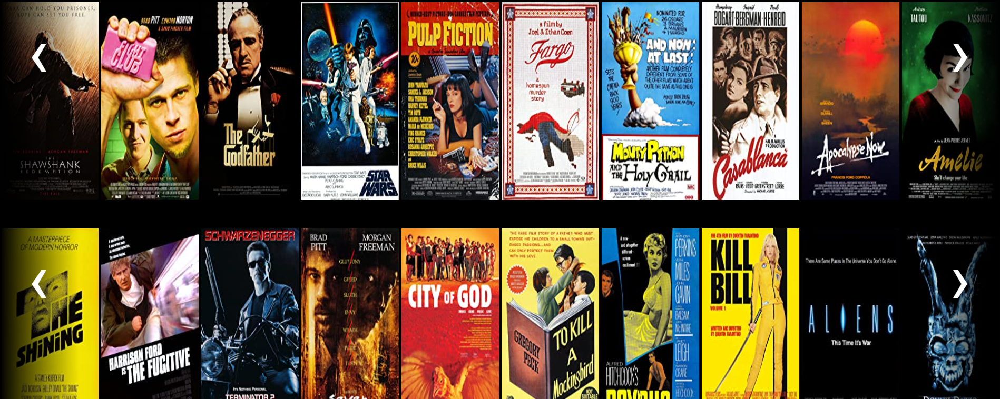
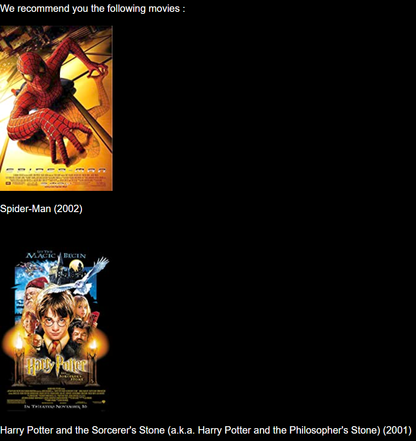

### [e-Commerce Chatbot in Rasa and Python](https://github.com/Zaamine/eCommerce_Chatbot-Rasa_Python)
Implemented a Chatbot (Virtual Assistant) in Python which automates the customer service of an e-commerce website.

* Possibility for the user to get from the chatbot:
	* answers to questions about the company and its services
	* additional information about the products sold by the company
	* a change in his account information such as the first name used on the website, phone number and email address
* Possibility for the user to make requests directly through the chatbot, such as:
	* sending a request directly to the company's customer service department so that it can be processed at a later date
	* suggesting a new product the company should sell on the website
	* providing a feedback regarding his chat experience at the end of each conversation
* Designed 22 conversation scenarios based on the writing of 2211 examples of user intents as NLU training data and 768 chatbot responses in English on the Rasa framework
* Used Rasa Open Source for the chatbot architecture
* Used Rasa Action Server to execute "custom actions" allowing the chatbot to validate forms and query a MySQL database
* Integrated the chatbot on a local copy of a PHP e-commerce website as a rest API using the Webchat plugin in JavaScript

<!-- The article I wrote about this project on [Medium](https://amine-zaamoun.medium.com/): [article title](article url) -->

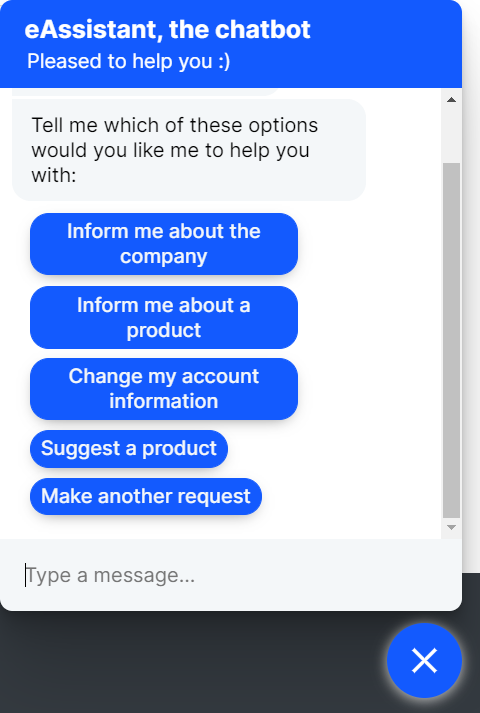

### [Analyzing Arsenal 2003-2004 Invincibles run using Network Science](https://github.com/Zaamine/Analyzing_Arsenal_2003_2004_Invincibles_run_using_Network_Science/blob/main/MLNS_Project-Arsenal_Invincibles_run-ZAAMOUN-CORNELUS_JOUAIDI_ELBIARI.pdf)

Analyzed Arsenal FC’s unbeaten Premier League season using advanced graph-based techniques to extract tactical and structural insights from match data.

* Built passing networks for each match with players as nodes and passes as weighted edges using StatsBomb’s event data API
* Computed key graph metrics (degree, betweenness, closeness, eigenvector centrality, PageRank, etc.) to identify key players and their tactical roles
* Used xG (Expected Goals) modeling and passing flow analysis to highlight game momentum and performance peaks across key matches
* Trained a Graph Convolutional Network (GCN) to classify match outcomes based on passing network structure, achieving 75% accuracy despite a small dataset
* Quantified continuity of the starting XI throughout the season using Graph Edit Distance and Node2Vec embeddings with cosine similarity

📄 Paper: *Analyzing Arsenal 2003–2004 Invincibles run using Network Science*  
🗂 Status: Internal academic project — available in [this](https://github.com/Zaamine/Analyzing_Arsenal_2003_2004_Invincibles_run_using_Network_Science/blob/main/MLNS_Project-Arsenal_Invincibles_run-ZAAMOUN-CORNELUS_JOUAIDI_ELBIARI.pdf) link

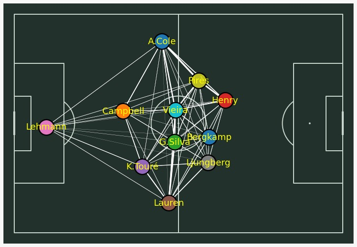
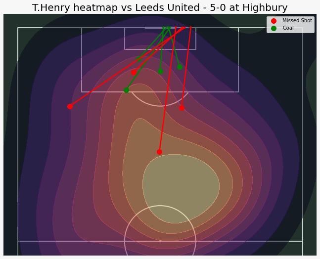
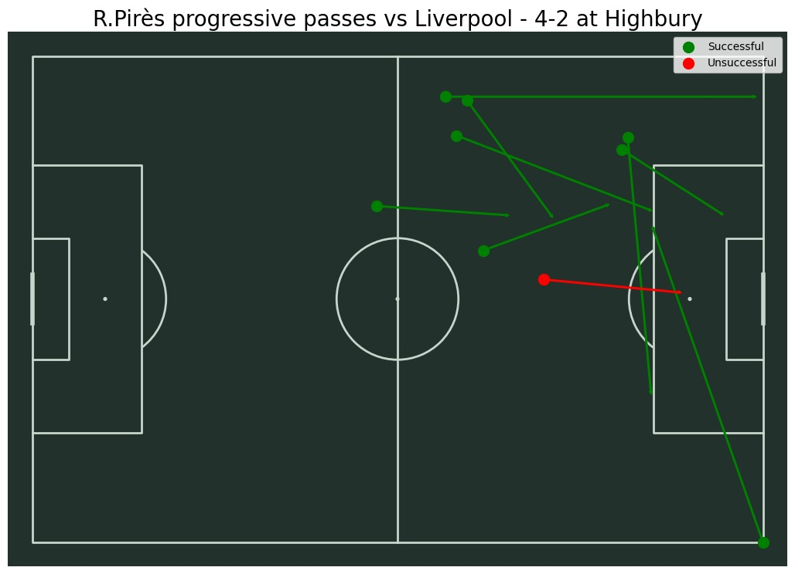
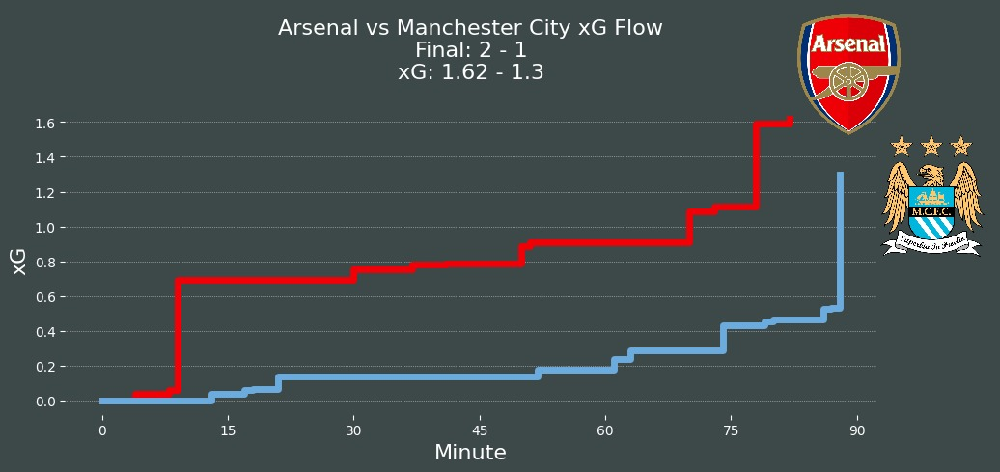

### [Building a BI Decision-Support Dashboard for FC Barcelona’s Post-Messi Era](https://github.com/Zaamine/FC_Barcelona_Business_Intelligence_Dashboard/blob/main/BI_final_project_presentation-Amine_ZAAMOUN.pdf)

Created a comprehensive and interactive Tableau dashboard using real-life match statistics and FIFATM video game attributes to support FC Barcelona's team management following Messi’s departure.

* Combined five seasons of match event data (StatsBomb) with FIFATM in-game player statistics to analyze player evolution, form, and suitability for future roles
* Built data pipelines in Python for extraction, cleaning, merging, and enhancement of datasets, transforming raw stats into actionable features
* Modeled the data using both a conceptual ER schema and a logical snowflake schema, enabling dynamic linking of player, club, season, and match statistics
* Designed visualizations for performance tracking, radar-based skill comparison, and strategic planning: player renewal/sale decisions, match strategy, and talent identification
* Delivered four key insights through a dashboard story format in Tableau, including Messi’s impact, aging squad concerns, renewal/sale decisions, and internal youth talent recommendations

📊 Tools used: Python, pandas, Tableau, StatsBomb API, FIFATM video game datasets \
📁 Project presentation available in [this](https://github.com/Zaamine/FC_Barcelona_Business_Intelligence_Dashboard/blob/main/BI%20final%20project%20presentation.pdf) link -  dashboard available upon request

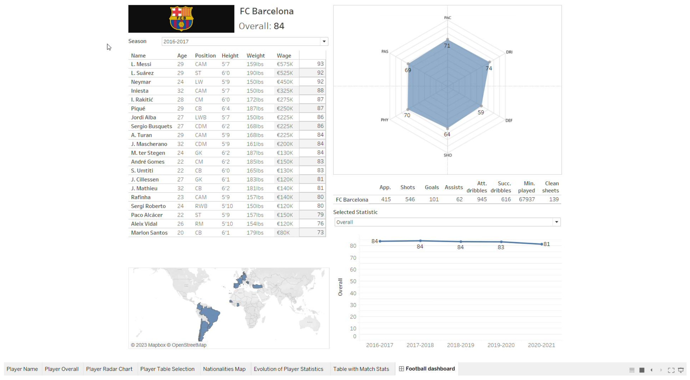
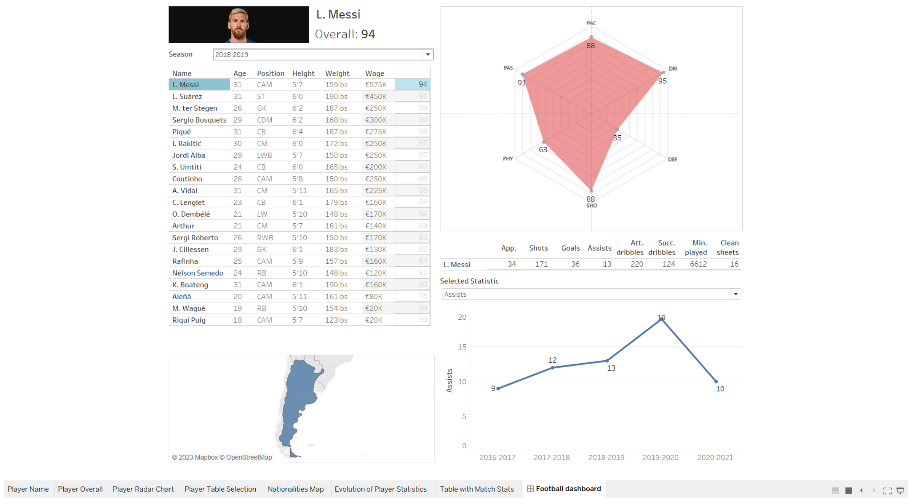

## Entrepreneurship & Leadership

### [Campus Grocery Startup E-commerce Website](https://github.com/Zaamine/DEUSPI)
Implemented an e-commerce website allowing the students of the campus of my school in France to provide themselves with food delivered in 15 minutes maximum by offering them a convenience store called “DEUSPI”.

* Front-end : HTML, CSS (Bootstrap) and JavaScript (jQuery)
* Back-end : PHP, jQuery’s Ajax and SQL (MySQL database)
* Ajax was mainly used to send and load information asynchronously in order to make the user experience as smooth as possible, while never leaving the product catalog page
* Twilio’s API was used to send a confirmation code to the user during registration, as well as to send additional information about his order
* Google maps’ “autocomplete” API was used to limit the scope of delivery and verify the user's address at the time of the order
* Stripe’s API has been used to secure credit card payment directly from our website without having to keep sensitive information about the user

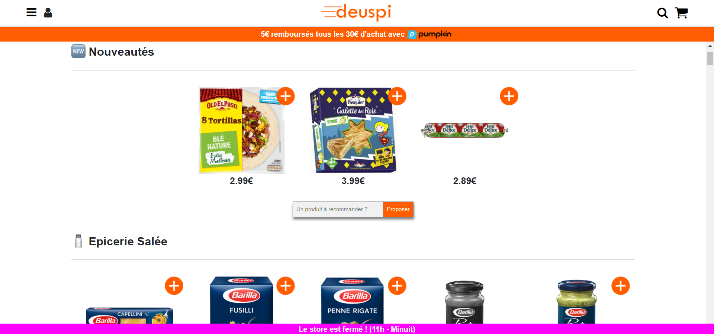
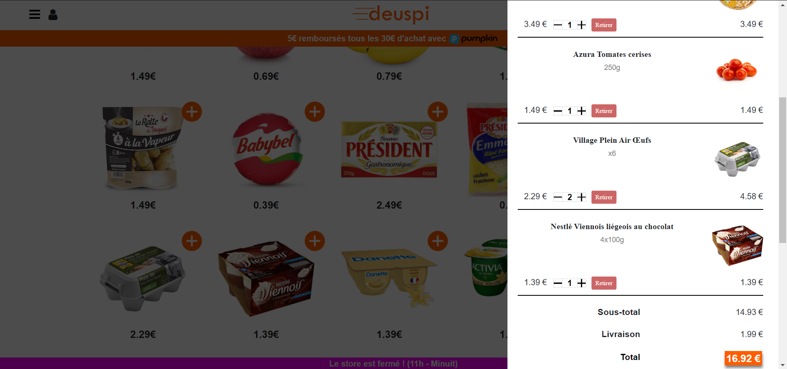

### [Presidency of the Data Oriented Thinking society (DOT)](https://www.linkedin.com/company/dot-essec-centrale/posts/?feedView=images)
The objective of DOT is to democratize Data Science by allowing students from all backgrounds at ESSEC and Centrale-Supélec to gain a thorough understanding of the domain and its different applications. As our world revolves increasingly around data collection, mining, predictions, and interpretations, it is essential for leaders of tomorrow to fully grasp data-oriented thinking. Indeed, outside the context of specific teachings such as the Master in Data Sciences & Business Analytics program in both schools, we have seen that this theme is often viewed as a distant subject and reserved for certain fields of study.

We, therefore, want to democratize the "hard" and "soft" skills that define this discipline to any interested student. This association wants to focus on this mix of know-how in order to apply it to problems that companies, institutions, or non-governmental organizations may encounter.
Students will learn from diverse sources of information: student-led workshops, masterclasses organized by companies, conferences from institutions, and much more. Through DOT, we wish to provide not only the basics to advanced theoretical knowledge on data science and analytics but also show the numerous practical uses of their realm (business, environmental, societal, health...). We also wish to formulate the forthcoming problematics of a data-driven world (biases, fake news, energy consumption, health crisis impact...).

- Managed a team of 13 other students to achieve DOT's goals
- Managed to negotiate several partnerships with key players in the world of Data Science: [Artefact](https://www.artefact.com/), [DataScientest](https://datascientest.com/), [Sia Partners](https://www.sia-partners.com/) and [Ekimetrics](https://ekimetrics.com/)
- Supervised the organization of several events throughout the year (coaching sessions with consultants, hackathons, masterclasses and networking events)
- Supervised the organization of in-house workshops in Data Science and its business applications in different industries
- Supervised writing of in-house articles in Data Science and its business applications in different industries

	<a href="https://www.linkedin.com/feed/update/urn:li:activity:6997199790107193344" rel="DOT members">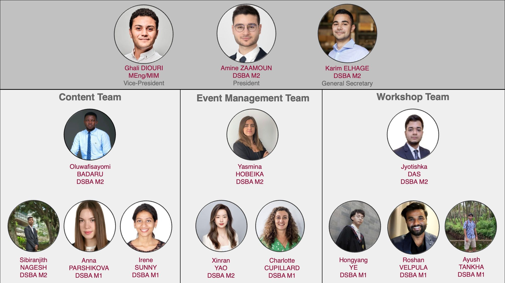</a>
	<a href="https://www.linkedin.com/posts/artefact-global_data-ia-datascience-activity-7019723395445477378-Zo8p" rel="DOT partnership with Artefact">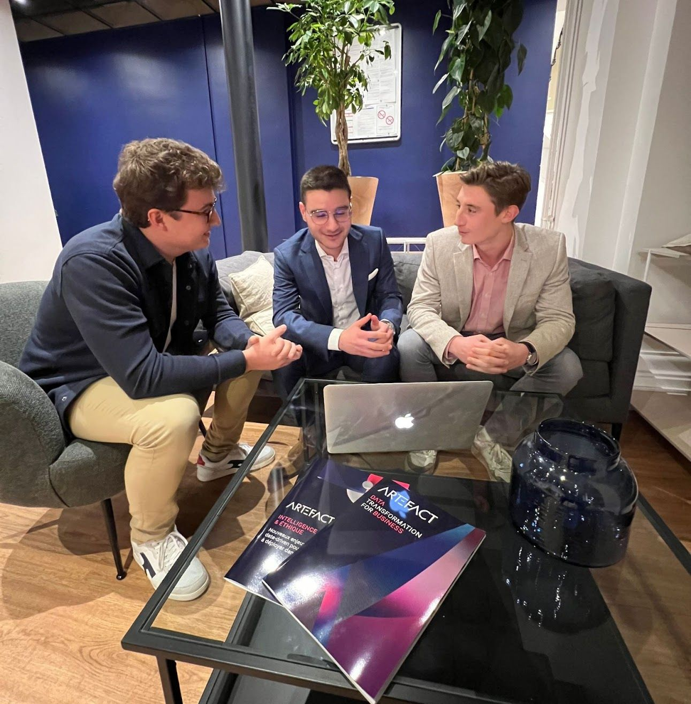</a>
	<a href="https://www.linkedin.com/pulse/unlocking-power-data-science-how-gaming-companies-transforming-/?trackingId=eiQMjRfFonZVk9K%2BC1rSAg%3D%3D" rel="DOT gaming in Data Science article">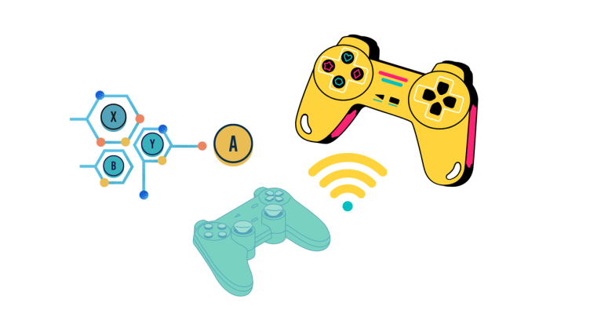</a>

### [Management of the training division of Centrale AI](https://github.com/Zaamine/Centrale_AI)
Former Training Manager of the “Centrale AI” association (“Centrale IA” in French) constituted in accordance with the French law of 1901 concerning non-profit organizations, allowing students of the Ecole Centrale de Lille to discover the Artificial Intelligence and Data Science's world:

- Established, supervised and presented complete trainings in Data Science, using the Python programming language
- Organized face-to-face or online meetings with Data Scientists of key accounts and startup companies, allowing students to extend their knowledge and professional network
- Organized events in connection with Data Science and prepared with my team a Hackathon gathering students from all schools of the “Groupe Centrale” in order to let them collaborate and challenge themselves

Video of the training on the Python library Numpy: [youtube.com/watch?v=LBIimDl2QHk](https://www.youtube.com/watch?v=LBIimDl2QHk&ab_channel=CentraleIA) \
Video of the training on the Python library Pandas: [youtube.com/watch?v=kTL-CetEbfA](https://www.youtube.com/watch?v=kTL-CetEbfA&ab_channel=CentraleIA) \
Events: [centraleia.fr/evenements](https://centraleia.fr/evenements/) and [centraleia.fr/conference](https://centraleia.fr/conference/)

	<a href="https://github.com/Zaamine/Centrale_AI/blob/main/1.Les_bases_1-Numpy/Numpy-librairie_calcul_optimise.ipynb" rel="formation numéro 1 Centrale IA Amine Zaamoun">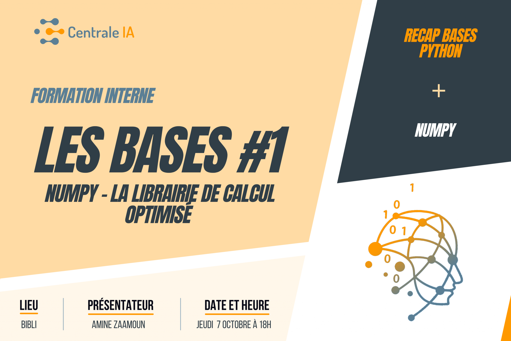</a>
	<a href="https://github.com/Zaamine/Centrale_AI/blob/main/2.Les_bases_2-Pandas/Pandas_librairie_analyse_donnees.ipynb" rel="formation numéro 2 Centrale IA Amine Zaamoun">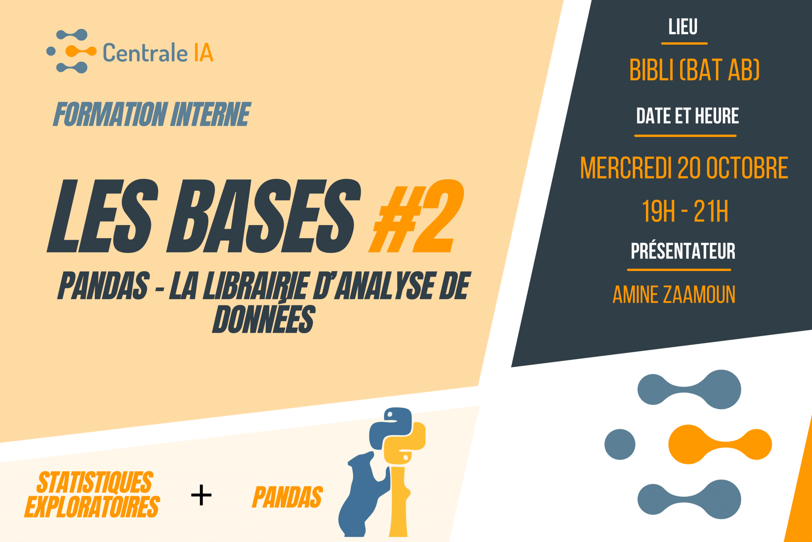</a>
	<a href="https://github.com/Zaamine/Centrale_AI/blob/main/5.Interpretabilite_et_ML/Interpretabilite_des_modeles_de_ML.ipynb" rel="formation numéro 5 Centrale IA Amine Zaamoun">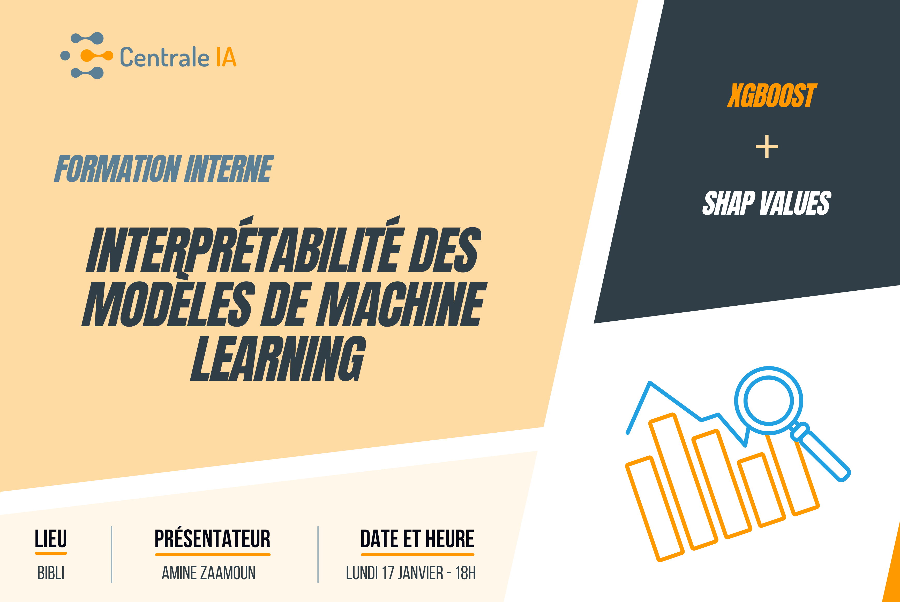</a>

 

# Languages and Tools:

- **Programming & Data:** Python, SQL, dbt, Bash, pandas, NumPy, SciPy, statsmodels, PySpark, REST, Streamlit
- **ML & GenAI:** scikit-learn, xgboost, shap, PyTorch, Bedrock, RAG, Fine-Tuning, LLM-as-a-Judge, agentic AI, MCP
- **Cloud & Orchestration:** AWS (IAM, S3, EC2, Glue, Redshift, Lambda, StepFunctions, EventBridge, CloudWatch)
- **Industrialization & MLOps:** Git, Docker, ECR, GitHub Actions, CI/CD, Registry, CT, MLflow, Drift Monitoring

[linkedin]: https://linkedin.com/in/amine-zaamoun
